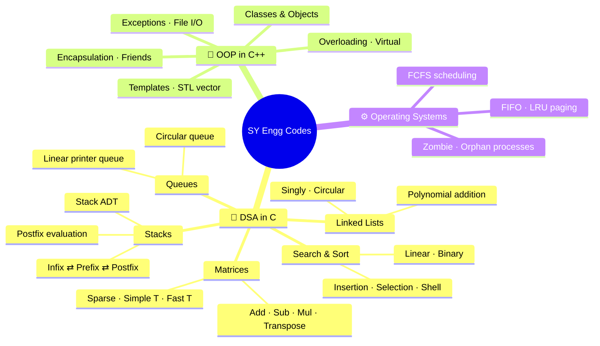
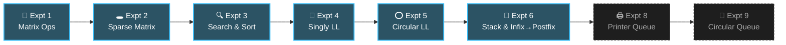
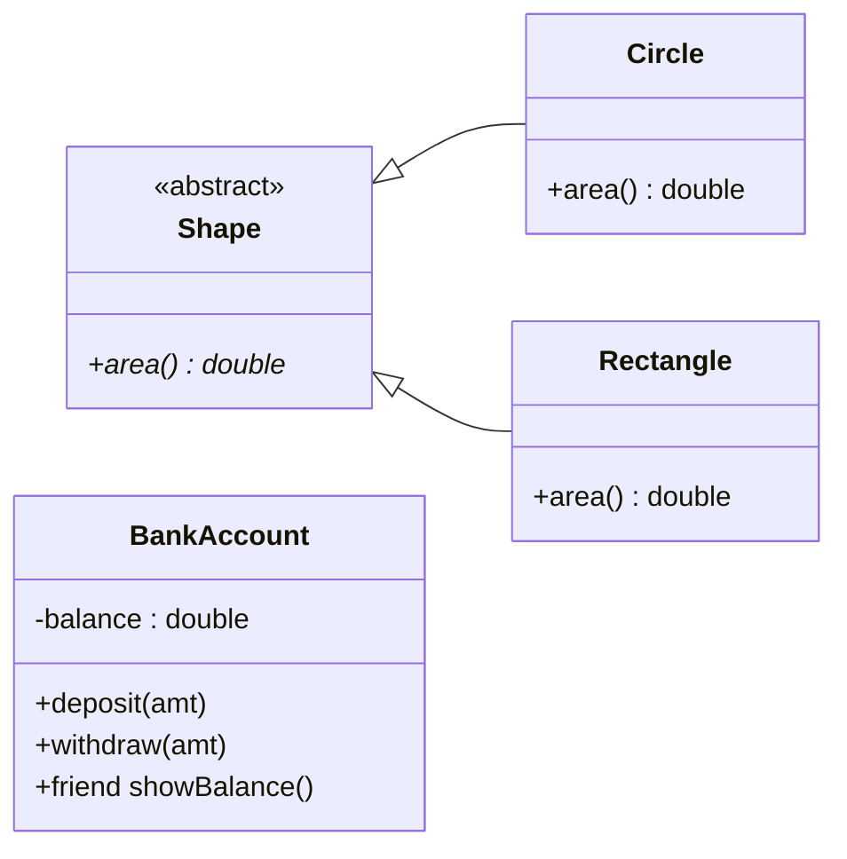
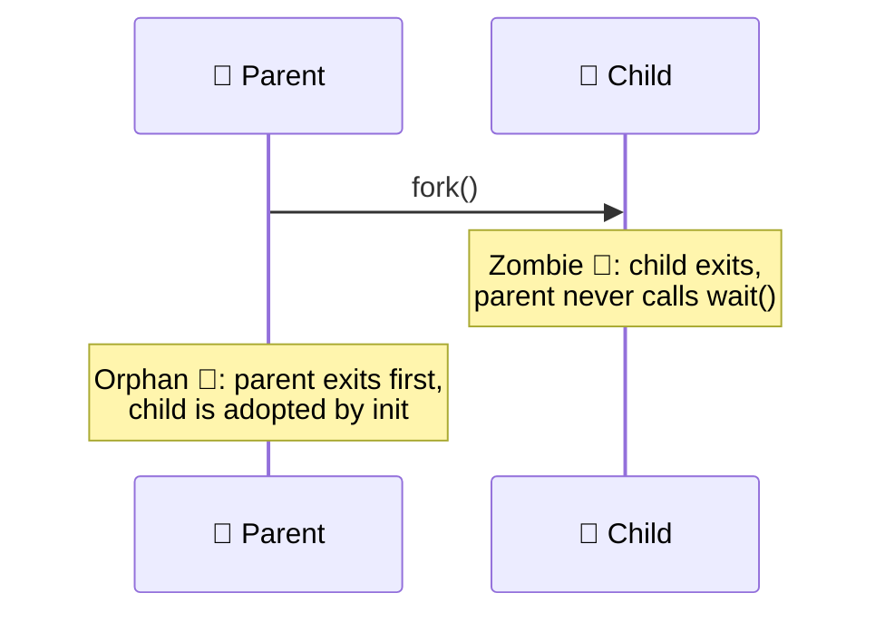

<div align="center">


<a href="https://github.com/Samarth-Bolkotgi-dev/SY-Engg-Codes">
  
</a>

<br/>


</div>

---

> **Not a code dump.** It's a semester spent learning to think in pointers, stacks and objects, one lab at a time.
> Every file here was written, compiled, broken and fixed again before a viva.

<br/>

## 🧭 The Map



<br/>

## 📊 By the Numbers

<div align="center">

| 📁 Subjects | 🧪 Lab Experiments | 📄 Source Files | 🧾 Lines of Code | 🎯 Exam-prep Programs |
|:---:|:---:|:---:|:---:|:---:|
| **3** | **19+** | **126** | **~8,300** | **70+** |

</div>

```text
 Language mix (by file)

 C     ███████████████████████████████████████░░░░░░░░░░░░  94 files   75%
 C++   █████████████░░░░░░░░░░░░░░░░░░░░░░░░░░░░░░░░░░░░░░  32 files   25%
```

<br/>

## 🚀 Publishing Progress

Everything lives on my machine first and lands here once it's cleaned up.

```text
 DSA · Expts 1–6    ████████████████████████████████████  ✅ live in this repo
 DSA · Expts 8–9    ░░░░░░░░░░░░░░░░░░░░░░░░░░░░░░░░░░░░  🔜 queued
 DSA · LCA Prep     ░░░░░░░░░░░░░░░░░░░░░░░░░░░░░░░░░░░░  🔜 queued
 OOP · C++          ░░░░░░░░░░░░░░░░░░░░░░░░░░░░░░░░░░░░  🔜 queued
 OS  · C            ░░░░░░░░░░░░░░░░░░░░░░░░░░░░░░░░░░░░  🔜 queued
```

---

## 🧱 Data Structures & Algorithms <sub><sup>— in C</sup></sub>

### 🗺️ The Learning Path



<sub>Solid boxes are published. Dashed ones are coming soon.</sub>

### 🧪 Experiments

<table>
<tr>
<th>#</th><th>Experiment</th><th>What's inside</th><th>Concepts</th>
</tr>

<tr>
<td align="center"><b>01</b></td>
<td><a href="DSA/Expt_1"><b>🔢 Matrix Operations</b></a></td>
<td><code>mat_add.c</code> · <code>mat_sub.c</code> · <code>mat_mul.c</code> · <code>mat_t.c</code></td>
<td>2-D arrays, nested loops, row × column product</td>
</tr>

<tr>
<td align="center"><b>02</b></td>
<td><a href="DSA/Expt_2"><b>🕳️ Sparse Matrix</b></a></td>
<td><code>Sparse_matrix.c</code> · <code>Simple_T.c</code> · <code>Fast_T.c</code></td>
<td>Triplet form, simple vs fast transpose</td>
</tr>

<tr>
<td align="center"><b>03</b></td>
<td><a href="DSA/Expt_3"><b>🔍 Search & Sort</b></a></td>
<td><code>Linear_search.c</code> · <code>Binary_search.c</code><br/><code>Insertion_sort.c</code> · <code>Selection_sort.c</code> · <code>Shell_sort.c</code></td>
<td>Divide & conquer, gap sequences, stability</td>
</tr>

<tr>
<td align="center"><b>04</b></td>
<td><a href="DSA/Expt_4"><b>🔗 Singly Linked List</b></a></td>
<td><code>singly_linked_list.c</code></td>
<td>Dynamic nodes, traversal, length, <code>malloc</code></td>
</tr>

<tr>
<td align="center"><b>05</b></td>
<td><a href="DSA/Expt_5"><b>⭕ Circular Linked List</b></a></td>
<td><code>circular_linked_list.c</code></td>
<td>Tail→head link, polynomial representation & addition</td>
</tr>

<tr>
<td align="center"><b>06</b></td>
<td><a href="DSA/Expt_6"><b>🥞 Stack & Expressions</b></a></td>
<td><code>stack_basic.c</code> · <code>infix_postfix.c</code><br/><code>infix_postfix_using_refcode.c</code></td>
<td>Stack ADT, operator precedence, associativity</td>
</tr>

<tr>
<td align="center"><b>08</b></td>
<td><b>🖨️ Printer Job Queue</b> <sub>🔜</sub></td>
<td><code>Linear_queue_printer_manager.c</code></td>
<td>Linear queue, enqueue / dequeue, overflow</td>
</tr>

<tr>
<td align="center"><b>09</b></td>
<td><b>🔄 Circular Queue</b> <sub>🔜</sub></td>
<td><code>Circular_queue.c</code></td>
<td>Modulo indexing, wasted-slot problem solved</td>
</tr>
</table>

### 🎨 How It Looks in Memory

<table>
<tr>
<td width="50%" valign="top">

**🔗 Singly Linked List**
```text
 head
  │
  ▼
┌────┬───┐   ┌────┬───┐   ┌────┬──────┐
│ 10 │ ●─┼──▶│ 20 │ ●─┼──▶│ 30 │ NULL │
└────┴───┘   └────┴───┘   └────┴──────┘
```

</td>
<td width="50%" valign="top">

**⭕ Circular Linked List**
```text
   ┌──────────────────────────────┐
   ▼                              │
┌────┬───┐   ┌────┬───┐   ┌────┬──┴┐
│ 3x²│ ●─┼──▶│ 2x │ ●─┼──▶│ 5  │ ● │
└────┴───┘   └────┴───┘   └────┴───┘
```

</td>
</tr>
<tr>
<td valign="top">

**🥞 Stack: `A+B*C` → `ABC*+`**
```text
 token  stack      output
 ─────  ─────────  ───────
   A    │      │   A
   +    │ +    │   A
   B    │ +    │   AB
   *    │ + *  │   AB
   C    │ + *  │   ABC
  end   │      │   ABC*+  ✓
```

</td>
<td valign="top">

**🔄 Circular Queue (size 5)**
```text
        front           rear
          ▼               ▼
  ┌─────┬─────┬─────┬─────┬─────┐
  │  ·  │ J2  │ J3  │ J4  │  ·  │
  └─────┴─────┴─────┴─────┴─────┘
     0     1     2     3     4
  rear = (rear + 1) % SIZE  ♻️
```

</td>
</tr>
<tr>
<td colspan="2">

**🕳️ Sparse Matrix → Triplet**
```text
  ┌             ┐        row  col  val
  │ 0  0  3  0  │        ───  ───  ───
  │ 0  0  0  0  │   ⇒     4    4    3     ← header (rows, cols, non-zeros)
  │ 0  7  0  0  │         0    2    3
  │ 0  0  0  9  │         2    1    7
  └             ┘         3    3    9
```

</td>
</tr>
</table>

### ⏱️ Complexity Cheat-Sheet

| Algorithm | Best | Average | Worst | Space | Stable? |
|---|:---:|:---:|:---:|:---:|:---:|
| 🔍 Linear Search | `O(1)` | `O(n)` | `O(n)` | `O(1)` | — |
| 🎯 Binary Search | `O(1)` | `O(log n)` | `O(log n)` | `O(1)` | — |
| 🃏 Insertion Sort | `O(n)` | `O(n²)` | `O(n²)` | `O(1)` | ✅ |
| 👆 Selection Sort | `O(n²)` | `O(n²)` | `O(n²)` | `O(1)` | ❌ |
| 🐚 Shell Sort | `O(n log n)` | `~O(n^1.3)` | `O(n²)` | `O(1)` | ❌ |
| 🔁 Simple Transpose | — | `O(cols · t)` | `O(cols · t)` | `O(t)` | — |
| ⚡ Fast Transpose | — | `O(cols + t)` | `O(cols + t)` | `O(cols)` | — |

<sub><i>t</i> = number of non-zero terms in the sparse matrix.</sub>

<details>
<summary><b>🎯 Exam & LCA prep vault</b> <sub>(click to expand · 🔜 coming soon)</sub></summary>
<br/>

A separate arsenal built for practicals and LCA:

| Folder | Contents |
|---|---|
| `Exam_Prep/` | Postfix evaluation, prefix ⇄ postfix, student DB (array + linked list) |
| `LCA_Prep/Codes/Separate/` | **32** single-purpose programs, one per sub-question (1a → 8d) |
| `LCA_Prep/Codes/Experiments/` | **11** full experiment solutions, incl. multi-digit postfix eval |
| `LCA_Prep/Codes/Conversions/` | All **6** expression conversions + one menu-driven "do-it-all" |
| `LCA_Prep/Codes/Mixed/` | **15** mixed-scenario problems (A1–A10, B1–B5) |
| `LCA_Prep/*.pdf` | Typeset notes for every experiment |

```text
          ┌──────────┐
          │  INFIX   │
          └──┬────▲──┘
             │    │
     ┌───────▼┐  ┌┴───────┐
     │ PREFIX │◀─▶│POSTFIX │      6 directions · 6 programs · 1 menu
     └────────┘  └────────┘
```

</details>

---

## 🧬 Object-Oriented Programming <sub><sup>— in C++</sup></sub> <sub>🔜</sub>



| Lab | Topic | Highlights |
|:---:|---|---|
| **1** | 🧭 Procedural vs OOP | Area calculator for shapes, the four pillars |
| **2** | 🏦 Classes & Friends | Bank account system, `friend` functions |
| **3** | 🎭 Polymorphism & Robustness | Function overloading, `virtual` dispatch, exceptions, file I/O |
| **6** | 💾 File Handling | Writing and reading objects vs plain text with `fstream` |
| **LCA** | 🧰 Templates & STL | `template<T>` stack, `std::vector`, 11 mixed real-world scenarios |

<details>
<summary><b>🧰 The 11 mixed scenarios</b></summary>
<br/>

`🏦 Bank` · `🎓 Student + vector + file` · `👔 Employee` · `🔢 Complex numbers` · `🔷 Shapes in a vector` · `🥞 Template stack` · `🌳 Inheritance types` · `📚 Library` · `📏 Distance (friend)` · `📌 Static & copy ctor` · `🧩 Template + vector`

</details>

---

## ⚙️ Operating Systems <sub><sup>— in C</sup></sub> <sub>🔜</sub>

<table>
<tr>
<td width="50%" valign="top">

**🗓️ FCFS Scheduling: Gantt Chart**
```text
 ┌──────┬────────┬───┬──────────┐
 │  P1  │   P2   │P3 │    P4    │
 └──────┴────────┴───┴──────────┘
 0      4        10  12         18
```

</td>
<td width="50%" valign="top">

**📄 Page Replacement (3 frames)**
```text
 ref:  7  0  1  2  0  3  0  4
 F1 :  7  7  7  2  2  2  2  4
 F2 :  ·  0  0  0  0  3  3  3
 F3 :  ·  ·  1  1  1  1  0  0
       ✗  ✗  ✗  ✗  ✓  ✗  ✗  ✗   (FIFO)
```

</td>
</tr>
</table>



| Program | What it shows |
|---|---|
| `fcfs.c` | First-Come-First-Serve with idle detection and a Gantt timeline |
| `Fifo.c` | FIFO page replacement with hit / miss tracking |
| `LRU.c` · `find_lru_index.c` | Least-Recently-Used replacement via last-use timestamps |
| `zombieprocess.c` | A child that dies but is never reaped |
| `orphanprocess.c` | A child that outlives its parent |

---

## 🗂️ Repository Layout

```text
SY-Engg-Codes/
├── 📁 DSA/
│   ├── 🔢 Expt_1/   matrix add · sub · mul · transpose
│   ├── 🕳️ Expt_2/   sparse matrix · simple & fast transpose
│   ├── 🔍 Expt_3/   linear/binary search · insertion/selection/shell sort
│   ├── 🔗 Expt_4/   singly linked list
│   ├── ⭕ Expt_5/   circular linked list (polynomials)
│   └── 🥞 Expt_6/   stack ADT · infix → postfix
├── 🔜 OOPS - CPP/
├── 🔜 OS/
└── 📘 README.md
```

---

## ⚡ Run Anything in 10 Seconds

```bash
# clone
git clone https://github.com/Samarth-Bolkotgi-dev/SY-Engg-Codes.git
cd SY-Engg-Codes

# compile & run any C program
gcc DSA/Expt_3/Binary_search.c -o bsearch && ./bsearch

# compile & run any C++ program
g++ -std=c++17 "OOPS - CPP/expt_2/bank_acc.cpp" -o bank && ./bank
```

> 💡 **Tip:** every program is a standalone `main()`. No build system and no dependencies, just a compiler.

---

## 🧠 Lessons the Compiler Taught Me

```diff
+ Always check if malloc() returned NULL.
+ Draw the linked list on paper before touching ->next.
+ (rear + 1) % SIZE is the most elegant line in the syllabus.
- Forgetting to free() is a memory leak; forgetting wait() is a zombie.
- Segmentation fault (core dumped) is not an answer in the viva.
```

---

<div align="center">

### ⭐ If this helped you survive a practical, leave a star.

<sub>Built with ☕, late nights and far too many <code>printf("here\n");</code> debug lines</sub>
<br/>
<sub>by <a href="https://github.com/Samarth-Bolkotgi-dev"><b>Samarth Bolkotgi</b></a> · Second Year Engineering</sub>


</div>
